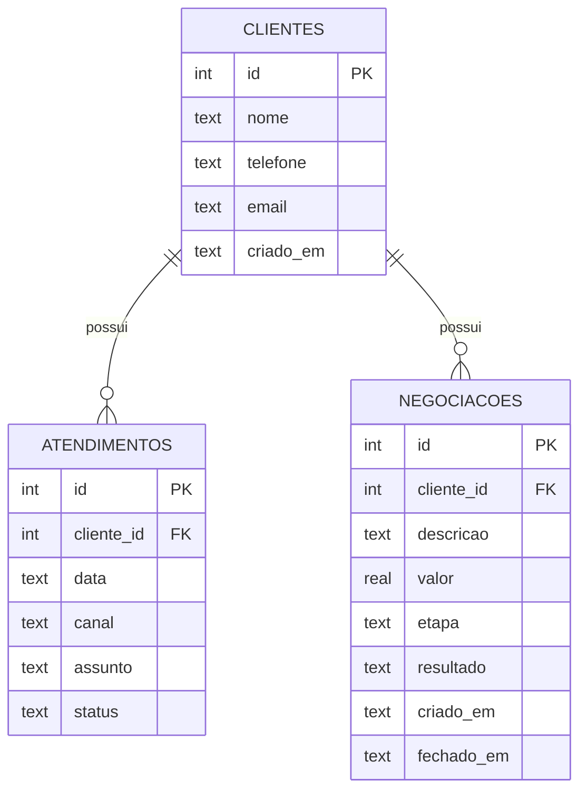

# Mini CRM de Atendimento

Sistema de linha de comando para registrar **clientes**, **atendimentos** e **negociações**, com relatórios simples e exportação para Excel (CSV). Feito em **Python** com **SQLite**, sem dependências externas.

O projeto nasceu da minha experiência como atendente de negócios: no dia a dia, eu controlava contatos com clientes e negociações em planilhas. Aqui transformei essa rotina em um sistema com banco de dados modelado, regras de negócio e testes automatizados.

## Funcionalidades

- **Clientes:** cadastrar, listar, buscar (por nome, e-mail ou telefone), editar e excluir
- **Atendimentos:** registrar contatos por canal (telefone, WhatsApp, e-mail, presencial) com status `aberto`, `em_negociacao` ou `fechado`
- **Negociações:** funil com as etapas `proposta`, `negociacao` e `fechamento`, encerrando como `ganha` ou `perdida`
- **Relatórios:** atendimentos por status, total negociado no mês e clientes sem contato há mais de 30 dias
- **Exportação:** qualquer tabela para CSV, pronto para abrir no Excel

## Tecnologias

Python 3.10+ · SQLite (módulo `sqlite3`) · pytest

## Como rodar

```bash
git clone https://github.com/SEU-USUARIO/mini-crm-atendimento.git
cd mini-crm-atendimento

python -m src.demo    # opcional: cria dados de exemplo
python -m src.main    # abre o menu do sistema
```

O banco `crm.db` é criado automaticamente na primeira execução.

## Testes

```bash
pip install -r requirements.txt
pytest
```

## Modelagem do banco



Ao excluir um cliente, seus atendimentos e negociações são removidos em cascata.

## Estrutura

```
mini-crm-atendimento/
├── README.md
├── requirements.txt
├── pytest.ini
├── src/
│   ├── banco.py          # conexão e criação das tabelas
│   ├── clientes.py
│   ├── atendimentos.py
│   ├── negociacoes.py
│   ├── relatorios.py     # relatórios e exportação CSV
│   ├── main.py           # menu de linha de comando
│   └── demo.py           # dados de exemplo
└── tests/
    └── test_crm.py
```

## Próximos passos

- [ ] Interface web (Flask ou FastAPI)
- [ ] Gráficos de negociações por mês
- [ ] Lembretes de retorno para clientes sem contato
- [ ] Importar clientes de uma planilha Excel

## Autora

**Anne Monteiro**, estudante de Análise e Desenvolvimento de Sistemas na Universidade São Judas Tadeu.
[LinkedIn](https://www.linkedin.com/in/seu-perfil) · [GitHub](https://github.com/seu-usuario)
